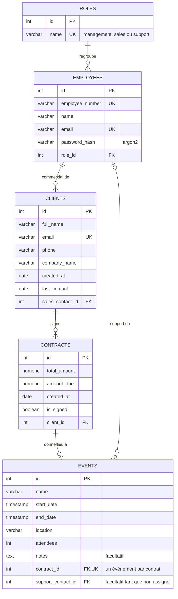

# Epic Events CRM

Application CRM en ligne de commande pour Epic Events, entreprise d'organisation d'événements.
Elle permet aux trois départements (gestion, commercial, support) de gérer les clients, les contrats
et les événements, chacun selon ses droits.

- Python 3.9 ou plus récent, interface en ligne de commande (click et rich)
- Base de données PostgreSQL, ORM SQLAlchemy
- Mots de passe hachés et salés avec argon2, authentification par jeton JWT
- Journalisation avec Sentry

## Droits par département

Tout collaborateur connecté peut **lire** les clients, les contrats et les événements.

| Action | Gestion | Commercial | Support |
|---|:---:|:---:|:---:|
| Créer, modifier, supprimer un collaborateur | ✅ | | |
| Créer un client (associé automatiquement à son créateur) | | ✅ | |
| Modifier un client | | ses clients | |
| Créer un contrat | ✅ | | |
| Modifier un contrat | tous | contrats de ses clients | |
| Créer un événement (contrat signé uniquement) | | ses clients | |
| Assigner un support à un événement | ✅ | | |
| Modifier un événement | tous | | ses événements |
| Filtrer les événements sans support | ✅ | | |
| Filtrer les contrats non signés ou non soldés | | ✅ | |
| Filtrer ses propres événements | | | ✅ |

Les droits sont accordés **par liste explicite de rôles**. Un nouveau rôle ajouté en base n'a accès à rien
tant qu'il n'est pas ajouté dans le code.

## Installation

### 1. Récupérer le projet et installer les dépendances

```bash
git clone <url-du-depot>
cd epicevents-crm
python3 -m venv venv
source venv/bin/activate
pip install -r requirements.txt
```

### 2. Créer la base de données et son compte

L'application utilise un compte PostgreSQL **non privilégié**, propriétaire de sa seule base.
En tant qu'administrateur PostgreSQL :

```bash
sudo -u postgres psql
```

```sql
CREATE ROLE epicevents_app WITH LOGIN PASSWORD 'choisir_un_mot_de_passe';
CREATE DATABASE epicevents OWNER epicevents_app;
\q
```

### 3. Configurer les variables d'environnement

Aucun secret n'est écrit dans le code. Copiez le modèle et remplissez-le :

```bash
cp .env.example .env
```

| Variable | Contenu |
|---|---|
| `DATABASE_URL` | `postgresql+psycopg2://epicevents_app:<mot_de_passe>@localhost:5432/epicevents` |
| `JWT_SECRET` | une longue chaîne aléatoire, générée avec `python -c "import secrets; print(secrets.token_urlsafe(48))"` |
| `SENTRY_DSN` | le DSN de votre projet Sentry (laisser vide pour désactiver Sentry) |

Le fichier `.env` est exclu du dépôt par `.gitignore`.

### 4. Créer les tables et les comptes de test

```bash
python init_db.py
python seed.py
```

`seed.py` crée les trois rôles et un compte de test par département. Il demande le mot de passe
de ces comptes au lancement : aucun mot de passe n'est écrit dans le code.

| Compte | Département |
|---|---|
| `admin@epicevents.local` | gestion |
| `bill@epicevents.local` | commercial |
| `kate@epicevents.local` | support |

## Utilisation

```bash
python epicevents.py --help
```

```bash
python epicevents.py login                  # le mot de passe est masqué à la saisie
python epicevents.py whoami
python epicevents.py logout
```

| Groupe | Commandes |
|---|---|
| `employee` | `list`, `create`, `update <id>`, `delete <id>` |
| `client` | `list`, `create`, `update <id>` |
| `contract` | `list [--unsigned] [--unpaid]`, `create`, `update <id> [--signed]` |
| `event` | `list [--no-support] [--mine]`, `create`, `update <id>`, `assign-support <id> --support-id <id>` |

Les commandes sans option posent leurs questions une par une. Les dates se saisissent au format `AAAA-MM-JJ HH:MM`.
Chaque commande accepte `--help`.

La session dure 8 heures. Le jeton est stocké dans `~/.epicevents/token`, lisible uniquement par
l'utilisateur système (droits 600). Une session par compte système : une nouvelle connexion remplace la précédente.

## Sécurité

| Risque | Mesure |
|---|---|
| Injection SQL | Requêtes générées par l'ORM. La seule requête SQL écrite à la main (`find_employee_by_email`) utilise un paramètre lié. Démonstration : `python demo_sql_injection.py` |
| Vol de mots de passe | Hachage argon2 avec sel aléatoire, jamais de mot de passe en clair |
| Usurpation de session | Jeton JWT signé (HS256, algorithme imposé), expiration après 8 heures, fichier en droits 600 |
| Accès non autorisé | Décorateur `require_role` sur chaque fonction d'accès aux données, refus par défaut, règles de propriété (un commercial n'agit que sur ses clients) |
| Données invalides | Validation des emails, téléphones, montants et dates avant écriture, liste fermée de champs modifiables |
| Fuite de secrets | Identifiants, secret JWT et DSN Sentry dans `.env`, exclu du dépôt |
| Privilèges excessifs | Compte PostgreSQL dédié, non superutilisateur |
| Énumération des comptes | Même message que l'email ou le mot de passe soit faux |

## Journalisation (Sentry)

Sont envoyés à Sentry :
- toutes les exceptions inattendues (l'utilisateur voit seulement un message court) ;
- chaque création, modification et suppression de collaborateur ;
- chaque signature de contrat.

Seuls des identifiants sont transmis, jamais d'email ni de mot de passe.

## Tests et qualité

Les tests utilisent une base SQLite en mémoire et un dossier de jeton temporaire : ils ne touchent ni à
la base PostgreSQL ni à la session en cours.

```bash
pytest --cov --cov-report=term-missing
flake8
```

## Schéma de la base de données



Choix de modélisation :
- Les départements sont une table `roles` reliée aux collaborateurs, et non une valeur écrite dans chaque compte.
- Le commercial d'un contrat est celui de son client : il est lu via le client et n'est pas stocké deux fois.
- Le support d'un événement est facultatif : un événement est créé avant que la gestion ne lui assigne un support.
- Les montants sont de type `NUMERIC(10, 2)` pour éviter les erreurs d'arrondi des nombres à virgule flottante.

## Structure du projet

| Fichier | Rôle |
|---|---|
| `epicevents.py` | interface en ligne de commande (click, rich), gestion centralisée des erreurs |
| `models.py` | modèles SQLAlchemy |
| `read.py` | lecture des données |
| `write.py` | création et modification, avec règles métier et validation |
| `auth.py` | hachage, jetons JWT, décorateur `require_role` |
| `token_storage.py` | stockage local du jeton |
| `monitoring.py` | intégration Sentry |
| `database.py` | connexion à la base |
| `init_db.py`, `seed.py` | création des tables et des comptes de test |
| `demo_sql_injection.py` | démonstration de la protection contre l'injection SQL |
| `tests/` | tests pytest |